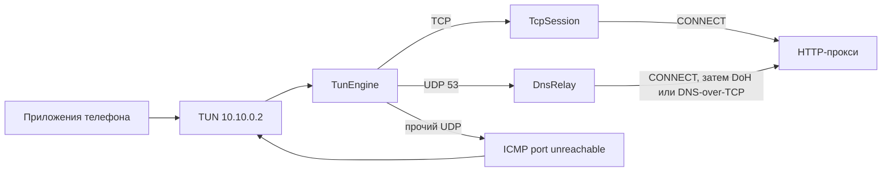

# Архитектура

HTTP VPN — это локальный IPv4-стек поверх Android TUN. Телефон считает, что говорит с настоящим сервером. На самом деле TCP завершается в приложении, а байты уходят в HTTP-прокси методом `CONNECT`.

## Модули

`:core` не знает про Android. Ему передают уже открытый поток (`Tunnel`) или фабрику сокета (`TcpDial`). Благодаря этому TCP и разбор пакетов покрыты обычными JUnit-тестами.

`:app` создаёт TUN, читает из него блокирующий дескриптор и пишет ответы обратно. Там же сокет к прокси уводится мимо VPN.

| Класс | Поток | Работа |
| --- | --- | --- |
| `HttpVpnService` | `http-vpn` | Читает TUN, публикует статистику, держит wake lock |
| `TunEngine` | поток чтения TUN | Раскладывает IPv4 на TCP и UDP |
| `TcpSession` | `tcp-<порт>` и `tcp-read-<порт>` | Стек одного соединения |
| `DnsRelay` | `httpvpn-dns` | Один DNS-запрос за раз |
| `VpnRuntime` | главный поток | Текст статуса для экрана |

Одновременно живёт не больше 400 TCP-сессий. Сверх этого новый SYN сбрасывается.

## TUN

`HttpVpnService.establishTun` настраивает интерфейс так:

- адрес `10.10.0.2/32`, MTU 1500, сессия «HTTP VPN»;
- DNS, который видит система: `8.8.8.8` и `1.1.1.1`;
- приложение само исключено из VPN;
- при включённой галке локальной сети маршруты берутся из `Routes.publicInternet`, иначе ставится `0.0.0.0/0`;
- с API 29 интерфейс помечается безлимитным (`setMetered(false)`), чтобы система не считала VPN дорогой сетью и не резала фоновые передачи.

Эти DNS-адреса Android использует как цель запросов. Сам запрос UDP/53 перехватывается и не уходит на IP из пакета. Ответ строит `DnsRelay` через прокси. В ответе сохраняется id исходного запроса, остальное берётся из ответа резолвера.

Чтение TUN — блокирующее, буфер 32767 байт. Остановка закрывает дескриптор, и `Os.read` выходит из ожидания.

## Куда девается пакет

`Packets.parseIpv4` принимает только IPv4 без фрагментов (ненулевое смещение или флаг more fragments). Короткие и битые заголовки отбрасываются.

Дальше `TunEngine`:

- протокол 6 — TCP;
- протокол 17 — UDP;
- остальное игнорируется. Своего IPv6 нет, адрес v6 на TUN не назначается.

### TCP

Ключ сессии — четвёрка источник IP, источник порт, назначение IP, назначение порт.

Первый пакет потока должен быть SYN без ACK. Иначе уходит RST. SYN на IPv4 и порт самого прокси тоже сбрасывается: это вторая линия против петли. Проверка по адресу работает для прокси с IPv4. Если прокси резолвится только в IPv6, остаётся исключение приложения и `protect`.

`TcpSession` отвечает SYN-ACK со своим номером последовательности и опцией MSS 1460. После ACK телефона сессия установлена. Параллельно уже открыт `CONNECT` на адрес назначения, записанный в пакете как IPv4-текст, и порт назначения. Имени хоста у туннеля нет: DNS к этому моменту уже разрешён телефоном.

Вверх (телефон → прокси): полезная нагрузка копится, пока её номер последовательности совпадает с ожидаемым. Совпавший кусок пишется в сокет прокси. Кусок из будущего не буферизуется. Уже принятый префикс отрезается. FIN телефона сдвигает номер на 1 и закрывает запись в сокет (`shutdownOutput`), когда буфер вверх пуст.

Вниз (прокси → телефон): читатель сокета кладёт байты в очередь. Сессия нарезает их по окну собеседника и по MSS, шлёт PSH+ACK. Ноль в окне: раз в секунду уходит один байт, чтобы разбудить окно. Самый старый неподтверждённый сегмент повторяется, начиная с 400 мс, интервал удваивается до 2 с, после 8 попыток сессия сбрасывается RST. Повтор в прокси не пишется.

Закрытие со стороны прокси становится FIN к телефону, когда исходящая очередь и неподтверждённые сегменты пусты. Сессия удаляется, когда обе стороны закрылись и очереди пусты. Без сегментов от телефона сессия живёт 15 минут.

Окно приёма в сторону телефона — остаток буфера вверх, потолок 256 КиБ.

### DNS

`DnsRelay.query` кэширует ответ на 60 секунд, не больше 256 записей, ключ — запрос без двух байт id.

Порядок получения ответа:

1. DoH `POST /dns-query` на `cloudflare-dns.com` (соединение на `1.1.1.1:443`) и затем `dns.google` (`8.8.8.8:443`). TLS поднимается поверх уже открытого `CONNECT`. Одно TLS-соединение переиспользуется.
2. Если DoH не ответил — DNS-over-TCP на порт 53 к `8.8.8.8` и `1.1.1.1`, тоже через `CONNECT`. Длина сообщения — два байта перед телом, как в RFC 1035.

Ошибка DNS пишется в статус не чаще раза в 5 секунд. Короткий или слишком длинный ответ в TUN не отправляется.

### Прочий UDP

`Packets.buildIcmpPortUnreachable` возвращает ICMP тип 3 код 3 и цитату исходного пакета. Приложение на телефоне видит закрытый порт и может повторить запрос по TCP. Это сознательное поведение, а не временная заглушка.

## HTTP CONNECT

`HttpCodec.establish` подключается к прокси, шлёт `CONNECT host:port HTTP/1.1` и ждёт заголовки. Код 2xx открывает туннель, таймаут чтения потом снимается. `407` означает неверный логин или пароль. Другой код — ошибка прокси.

Если логин или пароль непустые, добавляется `Proxy-Authorization: Basic`. Токен считается в UTF-8. Хост в запросе не может содержать перевод строки, пробел и `/`.

Таймауты соединения: 12 с для обычного TCP, 8 с для DNS, 10 с для кнопки «Проверить прокси». Кнопка открывает `CONNECT` до `example.com:443` обычным сокетом, без TUN, и поэтому недоступна, пока VPN включён.

## Как сокет прокси не попадает в TUN

Иначе `CONNECT` ушёл бы снова в `TunEngine`.

1. `addDisallowedApplication` убирает само приложение из VPN.
2. Сокет биндится на `0.0.0.0` или `::` и передаётся в `VpnService.protect`. Если обычный `protect(Socket)` не сработал, берётся файловый дескриптор.
3. `ConnectivityManager` выбирает сеть с интернетом и без транспорта VPN и делает `bindSocket`. Сеть обновляется колбэком `NET_CAPABILITY_NOT_VPN`.
4. Если ни исключение, ни `protect`, ни привязка не удались, сокет закрывается.

Адрес прокси резолвится до `establish()`, поэтому поиск имени не зависит от туннеля.

## Настройки и экран

`Prefs` хранит хост, порт, логин, пароль и галку локальной сети в `SharedPreferences` с именем `http_vpn`. Запись синхронная (`commit`). Пароль лежит открытым текстом.

`MainActivity` на время подключения блокирует поля. `VpnRuntime` держит последний `VpnState` и доставляет его на главный поток. После пересоздания экрана статус берётся из этого снимка: служба его не дублирует в базе.

Служба — foreground типа `specialUse`. Уведомление низкого приоритета, действие «Отключить» шлёт `ACTION_STOP`. Частичный wake lock удерживается, пока туннель жив. `onRevoke` (система забрала VPN) останавливает ту же цепочку, что и кнопка.

## Ограничения стека

Их полезно помнить, прежде чем «доделать TCP»:

- нет выборочного подтверждения и своего congestion window, только окно телефона;
- дырка в последовательности не собирается;
- повторяется только самый старый неподтверждённый сегмент;
- IPv4-фрагменты выбрасываются;
- UDP кроме DNS не проксируется;
- трафик приложений IPv6 в туннель не попадает.
